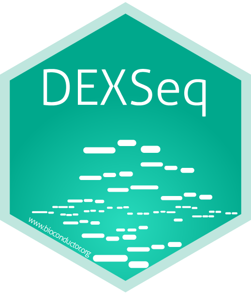

---
format:
  gfm:
    default-image-extension: ""
---

<!-- README.md is generated from README.qmd. Please edit that file -->

```{r}
#| include: false
knitr::opts_chunk$set(
  collapse = TRUE,
  comment = "#>",
  fig.path = "man/figures/README-",
  out.width = "100%"
)
```

# DEXSeq 

<!-- badges: start -->
<!-- badges: end -->

The package is focused on finding differential exon usage using RNA-seq exon counts between samples with different experimental designs. It provides functions that allows the user to make the necessary statistical tests based on a model that uses the negative binomial distribution to estimate the variance between biological replicates and generalized linear models for testing. The package also provides functions for the visualization and exploration of the results.

## Installation

You can install this package from Bioconductor:

``` r
# install.packages("BiocManager")
BiocManager::install("DEXSeq")
```

You can also install the development version from [GitHub](https://github.com/Huber-group-EMBL/DEXSeq) with:

``` r
# install.packages("BiocManager")
BiocManager::("Huber-group-EMBL/DEXSeq")
```

## Usage

Please refer to the [vignette](https://huber-group-embl.github.io/DEXSeq/articles/DEXSeq.html) for detailed usage instructions and examples on how to perform differential exon usage analysis with DEXSeq.
